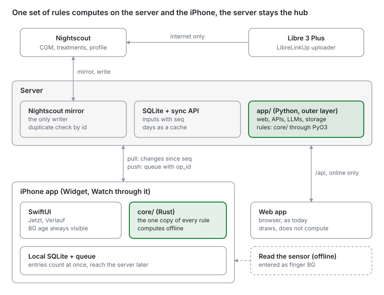

# Rust calculation core

A port of the app's calculation core to Rust, so a native client (iPhone app, widget, Watch through the
phone) can compute everything offline with the same rules as the server. The Python code in `app/`
stays the reference; nothing in the server uses this crate yet. The target picture is in
[docs/architecture.svg](../docs/architecture.svg).



## What is ported

| Rust module | Python reference |
| --- | --- |
| `calculation` | `app/calculation.py`: meal window, pre-bolus, endpoint, meal factor |
| `episodes` | `app/episodes.py`: normalizing Nightscout records, snack grouping, meals of a day |
| `on_board` | `app/on_board.py`: "Wirkt noch" (insulin, stomach, surcharge, sport) |
| `dosing` | `app/dosing.py`: dose options |
| `split`, `correction_scale`, `fpe` | split bolus, correction scale and dose slider, fat/protein surcharge |
| `glucose`, `glucose_alerts`, `correction_check` | CGM status and trend, early warnings, "BZ prüfen" |
| `forecast`, `stats` | Automatik incl. place factor, backtest, tuning, trade-offs |
| `services` | `app/services/dose_help.py` with the parts of `factors.py` and `store/marks.py` it reads |
| `day` | `app/services/day_view.py` `compute_day` with `app/analysis/night.py`: the diary day payload |
| `summary` | `app/services/summary.py` `compute_summary` with `factors.meal_points` and `app/sport_analysis.py` |
| `zone`, `context` | travel time zones (`common.TravelZone`), language of the texts (`app/i18n.py`) |

Not ported yet: the entry form's rules (`app/services/entry.py`: snack assignment, closing a meal, the
tapped-suggestion check), the diary edits (`diary.py`), the window editor, reminders (`notifications.py`),
dish outcomes (`dishes.py`) and the rest of `factors.py`. Never ported: storage, Nightscout sync, the web
server, the meal agent and the LLM providers.

## Target: every calculation in Rust

The user's decision (2026-11-27): every calculation rule lives once, in this crate; Python keeps the
outer layers (web server, SQLite store, Nightscout sync, LLMs, read API, MCP). Python reads what a rule
needs from the store into a JSON snapshot (`day_view.day_snapshot`, `summary.summary_snapshot`,
the dose help's snapshot) and calls the core with it through the PyO3 module; the answer already has the
shape the page reads. Once a module's Python rules are switched to the core, they are deleted and their
recorded calls become the core's golden tests. Coarse calls (a whole day, a whole analysis page) matter:
a call per reading would cost more in JSON than it saves.

Measured on 90 real days: the server's time goes mostly to reading and decoding stored payloads from
SQLite; the core pays off for the Automatik (backtest, tuning, trade-offs) and the day payload. The Rust
analysis page for all five periods takes about 1.9 s including process start and JSON parsing.

## Differences to the reference

Typed structs replace the reference's dicts and `rust_decimal` its `Decimal` (28 digits). Values agree
with the reference within the last digits; every rule decision and every dose in 0.5 IE steps agrees
exactly on the recorded calls. Numbers in JSON results are strings in their natural form (`"2.5"`, not
`"2.50"`), instants are RFC 3339 in UTC.

## Interface

One function, JSON in and out: `api::call("module.function", args)` with the reference's parameter
names; `services.dose_help` takes a whole snapshot (see `services::Snapshot`). `core-call` exposes it
as a line protocol on stdin/stdout:

```
{"fn": "dosing.half_units", "args": {"units": "2.26"}}
{"ok":"2.5"}
```

## Checking against the reference

```
cargo build --release --manifest-path core/Cargo.toml
python3 core/parity/record.py      # runs the Python test suite and records every distinct core call
python3 core/parity/compare.py     # replays them against the Rust core
```

`core/parity/days.py path/to/app.sqlite3` and `core/parity/summary.py path/to/app.sqlite3` compare the
day payload of every mirrored day and the analysis page of every period on a copy of a real database,
locally only (nothing is recorded or written; never commit a database or its output).

CI runs both steps (job `core-parity`) on every push. The recording holds synthetic test data only (`calls.jsonl`, ignored by git); never record from a real
database.
